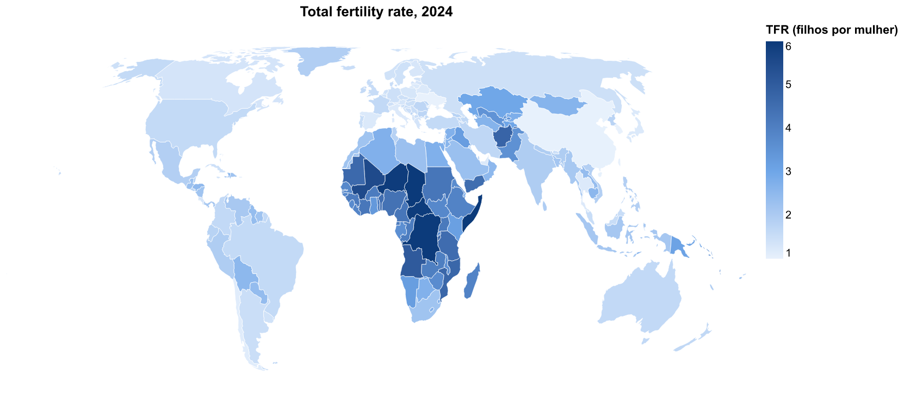
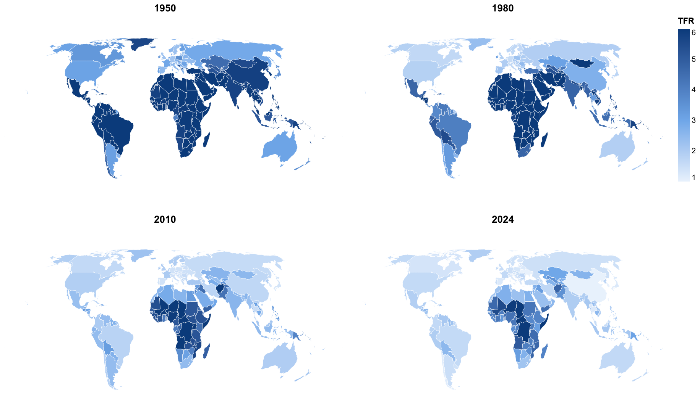
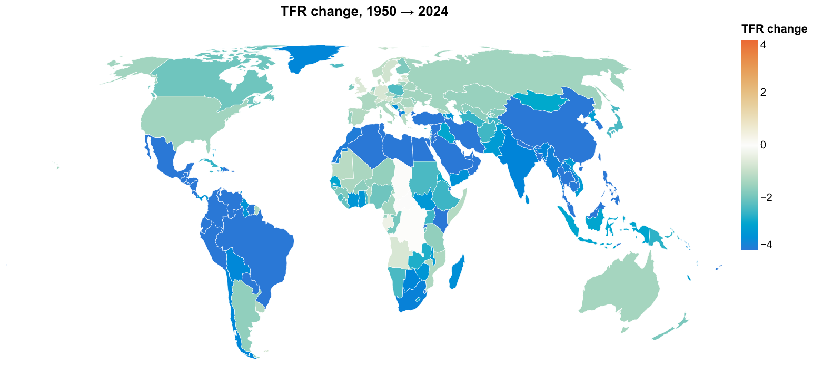
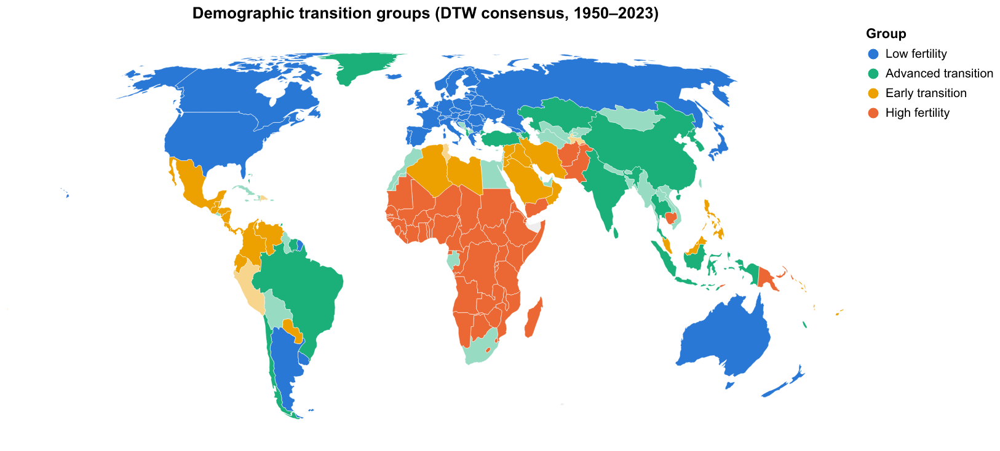
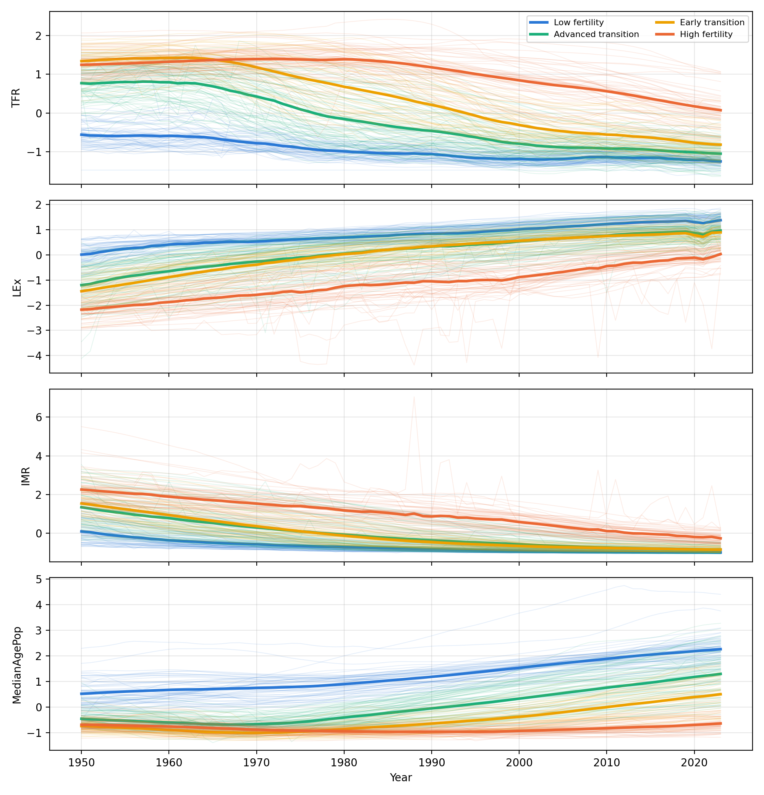
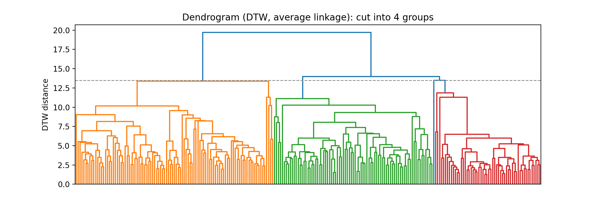
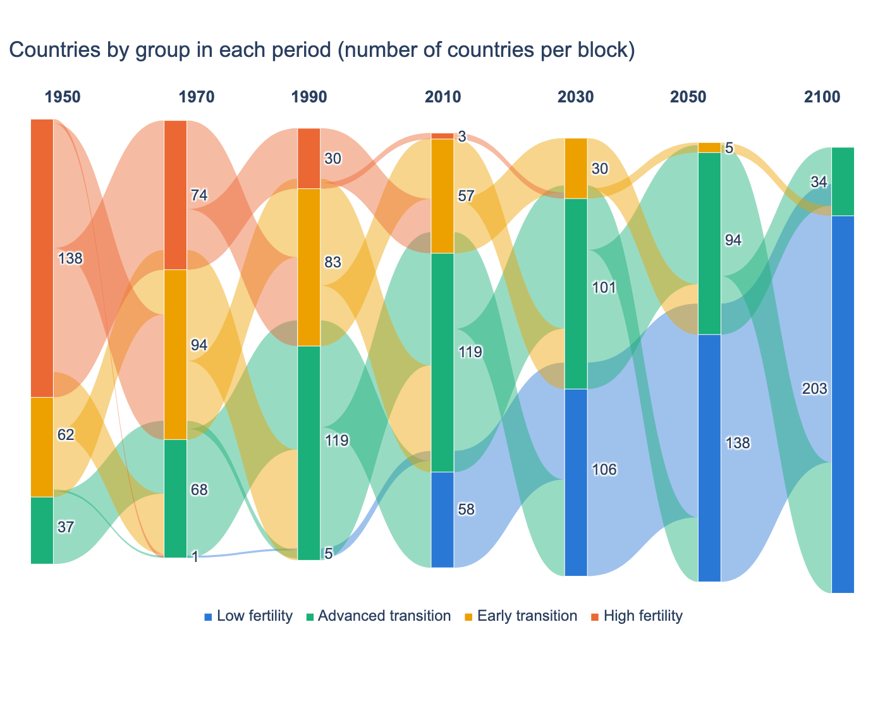
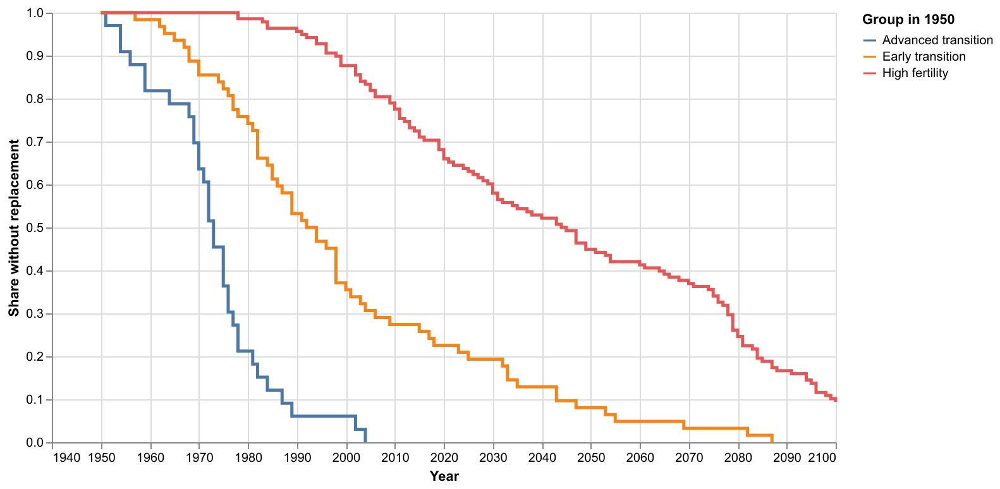
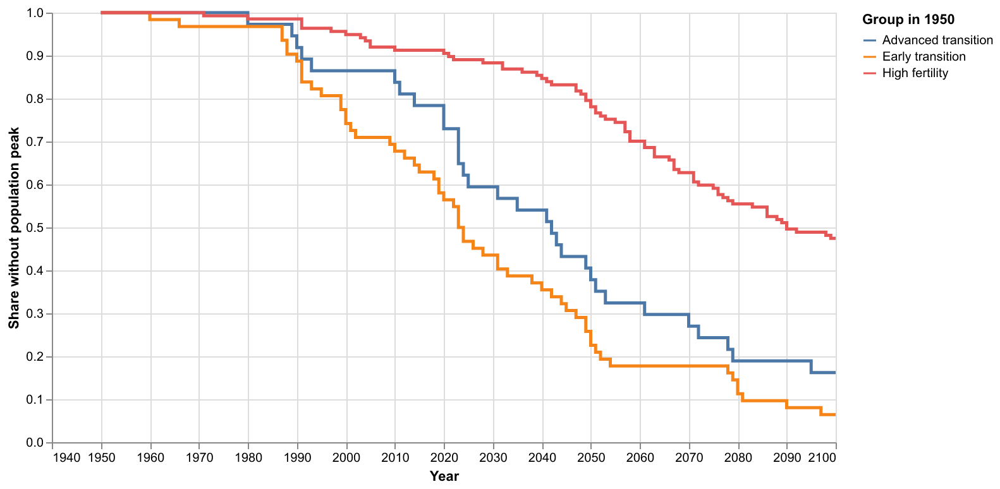
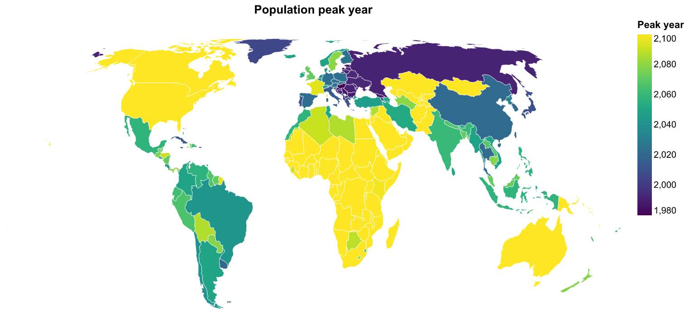

# DataQuest 2026 (ASA)

Análise dos dados do **World Population Prospects 2024 (WPP2024)** da ONU para o
ASA DataQuest 2026. A análise vai da exploração dos dados até a classificação dos países
em grupos de transição demográfica, com testes estatísticos, análise de sobrevida e
modelos de progressão entre grupos.

## Estrutura

```
data/
  raw/          dados originais (NÃO versionados)
  processed/    dados derivados (clusters, parâmetros, riscos)
src/
  dados.py      funções de carregamento dos dados
  preparo.py    filtragem, padronização e matrizes para a clusterização
scripts/
  copiar_dados.py   copia os dados do zip baixado para data/raw/
notebooks/
  01_exploracao.ipynb            exploração, teoria, correlação e VIF
  02_mapas_e_animacoes.ipynb     mapas, GIFs e visualizações
  03_testes_estatisticos.ipynb   testes de hipótese e intervalos de confiança
  04_clusterizacao_dtw.ipynb     clusterização DTW, consenso, KNN e Sankey
  05_analise_sobrevida.ipynb     Kaplan-Meier e Cox sobre o tempo até a reposição
  06_biomatematica.ipynb         crescimento logístico e lei de Gompertz
  07_risco_progressao.ipynb      risco de avançar de grupo por país
figures/        gráficos e GIFs gerados pelos notebooks
```

## Dados

Os dados **não** são commitados, mas estão disponíveis para download em:

[https://www.dropbox.com/scl/fo/0a10cwxgq3l2ascqpe926/AH5JxSDo6dYsMqqxqcT0NFk?rlkey=rea1m5k15ijcr3o86pfr6hbft&st=lioxqzvy&dl=0](https://www.dropbox.com/scl/fo/0a10cwxgq3l2ascqpe926/AH5JxSDo6dYsMqqxqcT0NFk?rlkey=rea1m5k15ijcr3o86pfr6hbft&st=lioxqzvy&dl=0)

Depois de baixar o `.zip`, **não precisa descompactar**. Coloque o zip na raiz do repositório e rode o script, que copia os arquivos para `data/raw/`, onde o código os procura:

```bash
python scripts/copiar_dados.py "2026 ASA DataQuest.zip"
```

Se preferir descompactar, aponte o script para a pasta:

```bash
python scripts/copiar_dados.py "CAMINHO/DA/PASTA"
```

O script copia os arquivos, sem movê-los, e avisa se algum estiver faltando. Os arquivos esperados são:

- `WPP2024_Demographic_Indicators_Medium_csv` (ou a versão `.gz`): série principal, 1950–2100
- `WPP2024_Demographic_Indicators_OtherVariants_csv` (ou a versão `.gz`): 18 cenários de projeção
- `WPP2024_Demographic_Indicators_notes.csv`: dicionário dos indicadores
- `WPP2024_Supplement_Births_and_LE60.csv`: nascimentos por sexo e expectativa de vida aos 60 anos
- `2026DataQuest_WPP2024_Getting_Started.docx` e `WPP2024_Supplement_Description.docx`

## Como rodar

```bash
python -m venv .venv
# Windows: .venv\Scripts\activate | Linux/Mac: source .venv/bin/activate
pip install -r requirements.txt
python scripts/copiar_dados.py "2026 ASA DataQuest.zip"
```

Os notebooks rodam a partir da pasta `notebooks/`. Os mapas usam a malha `world-110m`, carregada pela internet na primeira execução. A clusterização com DTW é lenta: o notebook 04 leva cerca de uma hora (com 5 inicializações por semente, a execução completa foi de cerca de 50 minutos em uma máquina com paralelismo).

## Resultados principais

Todas as figuras estão em `figures/`, com fundo branco e textos em inglês.

**Em resumo**
- A fecundidade mundial caiu de forma generalizada: a mediana entre países passa de cerca de 5,8 filhos por mulher em 1950 para cerca de 1,9 em 2024.
- Os países se dividem em quatro grupos de transição demográfica (DTW, K = 4). A divisão é moderadamente estável: a instabilidade não desaparece com mais inicializações, o que indica fronteiras reais entre grupos.
- Países de transição avançada em 1950 atingem a reposição (fecundidade abaixo de 2,1) por volta de 1973; os de transição inicial, em 1992; e os de alta fecundidade, em 2044.
- A projeção central da ONU (Medium) e a variante *Median PI* coincidem. Em 2100, a população mundial varia de cerca de 7 a 14 bilhões entre os cenários *Low* e *High*.

### Fecundidade no mundo



Em 1950, grande parte do mundo, incluindo África, Ásia e América Latina, tinha fecundidade alta. Em 2024, as taxas altas ficaram restritas à África Subsaariana e a poucos países.





### Grupos de transição demográfica (DTW)

Os países foram agrupados pela forma da trajetória de quatro indicadores (fecundidade, expectativa de vida, mortalidade infantil e idade mediana) entre 1950 e 2023, com DTW e k-means em K = 4. O resultado final é o consenso de 10 sementes, cada uma com 5 inicializações.







Cada execução concorda com o consenso em ARI médio de 0,65, e 54 países têm confiança abaixo de 0,6, sobretudo nas fronteiras entre grupos. O grupo de baixa fecundidade é o mais firme (confiança média de 0,97); o de transição avançada, o menos (0,55). Um classificador KNN treinado com os grupos acerta 91% dos países em validação cruzada.

A escolha de K = 4 é de interpretação: para o conjunto de indicadores sem filtro, K = 3 tem silhueta e estabilidade maiores. Essa decisão e a escolha do conjunto de indicadores estão justificadas no notebook 04.



O Sankey usa um único k-means com todas as épocas, então um grupo tem o mesmo significado em todo o período. As épocas de 2030 em diante são projeções.

### Tempo até a reposição e pico populacional



Nenhum país era de baixa fecundidade em 1950. A razão de risco da fecundidade de 1950 muda ao longo do tempo: nos primeiros 30 anos, cada desvio-padrão a mais reduz fortemente a chance de chegar à reposição; após cerca de 100 anos, o efeito se aproxima de nulo e, no horizonte de 150 anos, o sinal se inverte.





Cerca de 75 países ainda crescem em 2100 e ficam censurados na análise de pico. As medianas do pico são 2023 (transição inicial), 2042 (transição avançada) e 2090 (alta fecundidade).

### Transição entre grupos

A matriz de transição em intervalos de 20 anos mostra que, de 1950 a 2100, a maioria dos países avança de grupo quando sai do grupo de transição inicial ou de alta fecundidade, e que os países de transição avançada tendem a permanecer ou avançar para baixa fecundidade. Nesta versão não há retrocessos entre grupos.

O modelo logístico que tenta prever o avanço de cada país **não é confiável nesta versão**: a separação entre grupos é quase perfeita e os coeficientes são extremos. Por isso não apresentamos seus riscos individuais como resultado. O notebook 07 descreve a causa provável e o que fazer para corrigir.

### Evolução ao longo do tempo (GIFs)

- `fig_gif_population_growth_2_yearly.gif`: taxa de crescimento populacional de cada país, de 2 em 2 anos (1950–2100).
- `fig_gif_population_distribution_2_yearly.gif`: mapa da população e ranking dos 15 países mais populosos, de 2 em 2 anos.
- `fig_gif_countries_by_group_2_yearly.gif`: fecundidade e expectativa de vida de cada país, coloridos pelo grupo do consenso DTW.
- `fig_gif_tfr_map_1950_2100.gif` e `fig_gif_transition_1950_2100.gif`: fecundidade no mapa e transição demográfica, de 5 em 5 anos.
- `fig_gif_population_regions_1950_2100.gif`: população por região.

### Cenários de projeção

A variante *Median PI* coincide com o cenário Medium. Em 2100, a população mundial varia de cerca de 7 a 14 bilhões entre os cenários *Low* e *High*. Por isso as projeções devem ser lidas com a faixa de incerteza, não como um número único.

## Limitações

- Os eventos das análises de sobrevida e de progressão vêm de **projeções** para a maioria dos países, então descrevem o cenário Medium, não observações.
- Os p-valores de séries temporais de um mesmo país são otimistas, porque as observações são autocorrelacionadas.
- O mapa de 110 m não mostra países pequenos (ilhas do Pacífico e do Caribe, Santa Sé).
- A clusterização depende da semente; o consenso reduz, mas não elimina, a instabilidade.
- O modelo de progressão entre grupos (notebook 07) está instável nesta versão e não deve ser usado para previsões por país.

## Fluxo de trabalho

- Não faça push direto na `main`: crie um branch e abra um Pull Request.
- Nunca commite arquivos de `data/raw/` (o `.gitignore` já bloqueia).

## Referências

AGHABOZORGI, S.; SHIRKHORSHIDI, A. S.; WAH, T. Y. Time-series clustering review. *Information Systems*, [s. l.], v. 48, p. 16-39, 2015.

AMERICAN STATISTICAL ASSOCIATION. *Ethical Guidelines for Statistical Practice*. Alexandria: ASA, 2018. Disponível em: amstat.org. Acesso em: 30 out. 2026.

HENNIG, C. Cluster-wise assessment of cluster stability. *Computational Statistics & Data Analysis*, [s. l.], v. 52, n. 1, p. 258-271, 2007.

HUBERT, L.; ARABIE, P. Comparing partitions. *Journal of Classification*, [s. l.], v. 2, n. 1, p. 193-218, 1985.

LEE, R. The demographic transition: Three centuries of fundamental change. *Journal of Economic Perspectives*, [s. l.], v. 17, n. 4, p. 167-190, 2003.

PEDREGOSA, F. et al. Scikit-learn: Machine Learning in Python. *Journal of Machine Learning Research*, [s. l.], v. 12, p. 2825-2830, 2011.

REHER, D. S. The demographic transition revisited as a global process. *Population, Space and Place*, [s. l.], v. 10, n. 1, p. 19-41, 2004.

ROUSSEEUW, P. J. Silhouettes: a graphical aid to the interpretation and validation of cluster analysis. *Journal of Computational and Applied Mathematics*, [s. l.], v. 20, p. 53-65, 1987.

UNITED NATIONS. Department of Economic and Social Affairs. Population Division. *World Population Prospects 2024: Summary of Results*. New York: United Nations, 2024.

VANDERPLAS, J. et al. Altair: Interactive Statistical Visualizations for Python. *Journal of Open Source Software*, [s. l.], v. 3, n. 32, p. 1057, 2018.

WONG, L. L. R.; CARVALHO, J. A. M. de. O rápido processo de envelhecimento populacional do Brasil. *Revista Brasileira de Estudos de População*, Rio de Janeiro, v. 23, n. 2, p. 337-354, 2006.
